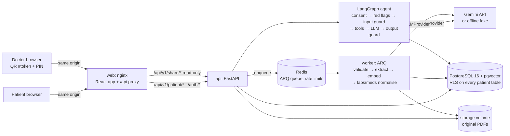

# Rakshak Kavach AI

Rakshak Kavach AI is a patient health records assistant. Patients upload digital medical PDFs (lab reports, imaging reports, prescriptions, doctor notes) and ask a LangGraph Medical History Agent questions that are answered only from their own records, with page-level citations. Lab values are extracted, normalised and compared in plain Python; urgent symptoms are caught by deterministic rules; and patients can share a read-only, patient-approved summary with a doctor through a QR code and PIN. It does not diagnose, predict or prescribe.

**Status:** v1 complete (M0–M17). See [`reports/MILESTONE_TRACKER.md`](reports/MILESTONE_TRACKER.md) and [`reports/FINAL_TECHNICAL_VERIFICATION.md`](reports/FINAL_TECHNICAL_VERIFICATION.md). Outstanding before real use:
- the first Docker image build and green GitHub Actions run (not possible from the build environment);
- a live Gemini evaluation;
- Langfuse tracing;
- clinician and compliance review.

**Specification:** [`PROJECT_SPEC.md`](PROJECT_SPEC.md) is the source of truth. Working rules are in [`AGENTS.md`](AGENTS.md).

## Architecture



- **API and worker:** connect as a non-owner role. Every request or job sets a transaction-scoped `app.patient_id`, and row-level security does the rest (ADR 0001, M6).
- **The LLM:** phrases answers and the summary narrative. Retrieval, lab maths, routing, safety rules, authorisation and sharing are deterministic code.
- **Doctors:** see only a frozen, patient-approved snapshot, cut down to the share's scope (ADR 0008).

## Features

- **Records:** upload digital PDFs (validated by magic bytes, size and page limits; per-patient dedup), processing status, open the original PDF, and deletion that removes everything derived from the document.
- **Assistant:** `/patient/chats` (persistent, RLS-protected LangGraph checkpoints) and `/patient/ask`. Answers carry citations to the exact PDF page, or a fixed "not found". Urgent symptoms get fixed emergency guidance.
- **Labs:** 47-test dictionary, unit conversion, reference ranges, DD/MM dates; deterministic previous-vs-latest comparison (improved / worsened / stable / insufficient / not comparable).
- **Medications** from prescription tables.
- **Summaries:** versioned snapshots built from SQL with a guarded, labelled AI narrative. The patient previews and approves; approved snapshots never change.
- **Sharing:**
  - A QR link (token in the URL fragment) plus a 6-digit PIN, with a permanent lock after 5 wrong PINs.
  - A 30-minute read-only doctor session; scope `summary_only` or `full_records`.
  - Revocation, and an access log showing self-declared doctor names.
- **Consent:** versioned notice. Revoking stops uploads and chat and revokes active shares.
- **Audit:** append-only `audit_log` with IDs and codes only.

## Run with Docker Compose

```bash
cp .env.example .env
# Edit .env: set POSTGRES_PASSWORD and APP_DB_PASSWORD (URL-safe, 16+ chars) everywhere they
# appear, JWT_SECRET_KEY (python -c "import secrets; print(secrets.token_urlsafe(48))"), and
# either GEMINI_API_KEY / GEMINI_CHAT_MODEL / GEMINI_EMBEDDING_MODEL or LLM_PROVIDER=fake
# (offline, development only).
docker compose up --build --wait
open http://localhost:8080                                 # app (nginx → API)
python scripts/seed_demo.py --base-url http://localhost:8080  # optional synthetic demo patient
```

Services: `postgres` (pgvector), `redis` (append-only file), `migrate` (Alembic plus app-role bootstrap, run once), `api`, `worker`, `web`. Ports are bound to `127.0.0.1` only. Production notes: [`docs/deployment.md`](docs/deployment.md); backups and runbook: [`docs/operations.md`](docs/operations.md).

## Develop and test

```bash
python3.12 -m venv .venv && . .venv/bin/activate && pip install -r requirements-dev.txt
ruff check . && ruff format --check .
pytest                                   # needs Docker (Testcontainers) or TEST_DATABASE_URL / TEST_REDIS_URL
cd frontend && npm ci && npm test && npm run build
npm run dev                              # http://localhost:5173; set FRONTEND_ORIGIN accordingly
```

To run tests against existing services, use a dedicated test database (tests truncate tables) whose owner may create roles (Compose's `POSTGRES_USER` can):

```bash
docker compose exec postgres createdb -U rakshak rakshak_test
export TEST_DATABASE_URL=postgresql+asyncpg://rakshak:<password>@127.0.0.1:5432/rakshak_test
export TEST_REDIS_URL=redis://127.0.0.1:6379/15
pytest
```

## Verified results (2026-11-11)

These were measured in the build environment: 1 vCPU, native services, offline LLM provider. **No Gemini quality or latency is claimed.**

| Check | Result |
|---|---|
| Backend tests | 321 passed, 0 failed, 0 skipped |
| Frontend tests (incl. axe accessibility) | 13 passed, 0 failed; production build passes |
| Golden eval, 26 cases ([`evals/golden_cases.yaml`](evals/golden_cases.yaml)) | answers 9/12 · not-found 1.0 · isolation 1.0 · red flags 1.0 · injection 1.0 · 0 cross-patient / 0 ungrounded citations |
| Retrieval eval, 20 questions | hit@6 0.90; RAG 0.85 vs long-context 0.85 answer accuracy (fake provider) |
| Tool selection, 10 questions | 10/10 |
| Safety eval (in-sample) | red-flag recall 22/22, precision 1.0; injection 8/8 blocked, 0/8 false blocks; output guard 12/12 blocked, 0/10 false blocks |
| Lab extraction (30 labelled rows) | precision 1.0, recall 1.0 |

Load test (k6, [`loadtest/README.md`](loadtest/README.md)), 0 errors in 13,102 requests:

| Workflow | p50 | p95 | Req/s |
|---|---|---|---|
| Reads | 17.8 ms | 24.3 ms | 208.4 |
| Ask (agent, fake LLM) | 51.8 ms | 79.6 ms | 53.0 |
| Login (argon2id) | 391.4 ms | 449.6 ms | 5.1 |
| Doctor share view | 11.5 ms | 17.6 ms | 157.9 |
| Document processing (upload → ready) | 526 ms | 656 ms | — |

CI ([`.github/workflows/ci.yml`](.github/workflows/ci.yml)):
- jobs: lint, test (disposable PostgreSQL/pgvector and Redis), migrations (`alembic check`), frontend, compose smoke test;
- live Gemini eval runs nightly or on demand in [`live-eval.yml`](.github/workflows/live-eval.yml).

## Documentation

- Decisions: [`docs/adr/`](docs/adr/) (ADRs 0001–0010).
- Threat model: [`docs/threat-model.md`](docs/threat-model.md).
- Milestone reports: [`reports/`](reports/) (M0–M17).
- Deployment, operations and load testing: [`docs/deployment.md`](docs/deployment.md), [`docs/operations.md`](docs/operations.md), [`loadtest/README.md`](loadtest/README.md).

## Limitations

- Digital PDFs only (no OCR).
- English-only red-flag rules, not clinically validated.
- Doctor identity is self-declared.
- Langfuse tracing is not integrated.
- Live Gemini performance is not yet measured.
- Not production-grade without encryption at rest, backup encryption, full RBAC and a formal review. Data handling is modeled on DPDP principles; this is not a compliance claim.
